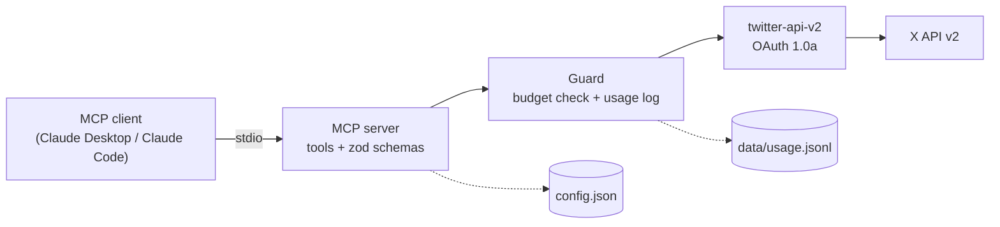

# safe-twitter-mcp

An X (Twitter) MCP server with cost guardrails, approve-before-post safety, and a local spend log.

[](LICENSE)
[](https://nodejs.org)
[](https://www.typescriptlang.org)
[](https://modelcontextprotocol.io)
[](https://github.com/saadatdev/safe-twitter-mcp/actions/workflows/ci.yml)

## Why

Since 2026 the X API is pay-per-use: every post read, user lookup and post created is billed
individually. An agent that runs a broad search, retries in a loop or posts a link without
noticing can turn a few minutes of work into a real bill, or publish something nobody approved.

This server gives an MCP client a small, deliberate set of X tools and puts a guard in front of
every API call. It checks daily budgets before spending anything, logs the estimated cost of
each call, and never publishes without a dry run followed by an explicit confirmation.

It works with any MCP client, such as Claude Desktop or Claude Code.

## Features

- **Dry run, then confirm.** Posting, threads and deletes return a preview first: final text,
  X-weighted character count, estimated cost and today's totals. Nothing is published until the
  tool is called again with `confirm: true`.
- **Daily caps.** Separate limits for posts read, posts created and estimated spend, counted in
  your own timezone. Calls that would cross a limit are refused up front with the remaining
  allowance and the config key to change.
- **Link-cost warning.** A post containing a URL costs about 13 times more. The preview flags it
  and suggests putting the link in a reply instead.
- **Duplicate detection.** Refuses an exact repeat of anything posted in the last 7 days.
- **Per-call cost log.** Every API call is appended to `data/usage.jsonl` with its endpoint,
  units and estimated cost; `get_usage_summary` reports today, 7 days or 30 days.
- **Human-readable errors.** 401, 402, 403 and 429 responses are translated into the specific fix
  (regenerate the token, add credits, wait until the reset time) with no stack traces and no secrets.
- **Config without restarts.** `config.json` is read on every call, so budget and watch-list
  changes apply immediately.

## Tools

| Tool | What it does | Approx. cost |
|---|---|---|
| `search_posts` | Recent search (last 7 days) with relevancy or recency sort; adds `-is:retweet lang:en` unless the query sets them | $0.005 per post returned |
| `get_account_posts` | Latest posts from one account, replies excluded by default | $0.005 per post, plus a one-time $0.01 username lookup (cached) |
| `get_watchlist_digest` | Latest posts from every watched account plus one topic search, grouped and ranked by engagement; refuses if the worst case exceeds today's budget | $0.005 per post returned |
| `get_my_mentions` | Recent posts mentioning the authenticated account | $0.001 per post |
| `get_my_posts` | The account's own recent posts with likes, reposts, replies and views | $0.001 per post |
| `create_post` | Publish a post, optionally as a reply or with images | $0.015, or $0.20 with a URL |
| `create_thread` | Publish 2–10 posts as a thread; on a mid-thread failure reports exactly which posts went out | $0.015 per post |
| `upload_media` | Upload a local png, jpg, gif or webp with optional alt text; returns a `media_id` | Not listed by X, logged as $0 |
| `delete_post` | Delete a post, only if the authenticated account wrote it | $0.01 plus a $0.001 lookup |
| `get_usage_summary` | Estimated calls, reads, posts and spend from the local log, plus remaining budgets | Free, no API call |

Dry runs (`confirm: false`) of `create_post` and `create_thread` are free; the `delete_post` dry
run fetches the post first. Tools that act on the authenticated account look up its id once
($0.01) and cache it.

## Architecture



Every X call goes through one wrapper, `guarded()` in [`src/x/client.ts`](src/x/client.ts). It
checks the planned worst case against today's budgets, makes the call, records the actual units
and estimated cost, and converts any error into an actionable message. stdout is reserved for
the MCP protocol, so all logging goes to stderr.

```
src/
  index.ts          server setup and tool registration
  config.ts         config.json loading and validation
  env.ts            .env loading and validation
  paths.ts          paths resolved relative to the build, not the working directory
  guard/            budgets, draft review, usage log and cost table
  tools/            one file per tool
  x/                API client wrapper, formatting, character counting, user cache
tests/              unit tests (no network, no keys)
scripts/smoke.ts    manual end-to-end check against the live API
```

## Quick start

### Prerequisites

- Node.js 22.12 or later
- An X developer account with pay-per-use credits (see [X developer setup](#x-developer-setup))
- An MCP client such as Claude Desktop or Claude Code

### Install and build

```bash
git clone https://github.com/saadatdev/safe-twitter-mcp.git
cd safe-twitter-mcp
npm install
cp .env.example .env                  # then fill in the four X keys
cp config.example.json config.json    # then set your timezone, topics and watch list
npm run build
```

On Windows PowerShell, use `Copy-Item` in place of `cp`.

### Smoke test

```bash
npm run smoke
```

This verifies the credentials (`GET /2/users/me`) and runs one 10-result search. It costs about
$0.06 and never posts.

### Connect to Claude Desktop

Open the config file (Claude Desktop → Settings → Developer → Edit Config):

- Windows: `%APPDATA%\Claude\claude_desktop_config.json`
- macOS: `~/Library/Application Support/Claude/claude_desktop_config.json`

Add the server under `mcpServers`, using the absolute path to `dist/index.js`. Windows paths need
escaped backslashes:

```json
{
  "mcpServers": {
    "safe-twitter": {
      "command": "node",
      "args": ["C:\\path\\to\\safe-twitter-mcp\\dist\\index.js"]
    }
  }
}
```

On macOS:

```json
{
  "mcpServers": {
    "safe-twitter": {
      "command": "node",
      "args": ["/Users/you/path/to/safe-twitter-mcp/dist/index.js"]
    }
  }
}
```

Quit Claude Desktop completely and reopen it, then ask it to show your X usage summary.
Credentials are read from the `.env` file next to the server, so they never go in the client config.

### Connect to Claude Code

```bash
claude mcp add --scope user safe-twitter -- node /absolute/path/to/safe-twitter-mcp/dist/index.js
```

## X developer setup

1. In [console.x.com](https://console.x.com), create a project and an app.
2. Under **User authentication settings**, set **App permissions** to **Read and write**.
3. **Regenerate the Access Token and Secret after changing permissions.** A token created
   before the change stays read-only, and every post fails with 403. This is the most common
   setup problem; the server's 403 message points to it.
4. Copy the API Key, API Key Secret, Access Token and Access Token Secret into `.env`.
5. Add credits under **Billing**. With a zero balance every call fails with 402, which the server
   reports as an empty credit balance.

## Configuration reference

`config.json` (copied from [`config.example.json`](config.example.json)) is read on every call.

| Key | Default | Meaning |
|---|---|---|
| `timezone` | `"UTC"` | IANA timezone that defines "today" for all daily limits and timestamps, e.g. `"Europe/Berlin"` |
| `topics` | 5 examples | Terms OR-joined into the digest's topic search; multi-word terms are quoted |
| `watch_accounts` | 5 public accounts | Handles (without `@`) that `get_watchlist_digest` pulls from |
| `reading.default_max_results` | `10` | Results per search when the caller doesn't specify (X minimum is 10) |
| `reading.max_results_cap` | `50` | Hard ceiling for `search_posts`; larger requests are lowered to this |
| `reading.default_query_suffix` | `"-is:retweet lang:en"` | Operators appended to searches unless the query already sets them |
| `posting.max_chars` | `280` | Character limit, counted the way X counts (URLs are 23, emoji and CJK are 2) |
| `posting.warn_on_links` | `true` | Warn in previews when a post contains a URL |
| `budget.daily_post_reads` | `300` | Max posts returned per day by search, account posts and digest (own posts and mentions don't count) |
| `budget.daily_post_creates` | `8` | Max posts created per day, thread posts included |
| `budget.daily_spend_usd` | `2.0` | Max estimated spend per day; any call that could exceed it is refused |

## Costs

The usage log prices calls with this table, from [`src/guard/usage.ts`](src/guard/usage.ts)
(as listed on 10 Oct 2026):

| Action | Price |
|---|---|
| Create a post | $0.015 |
| Create a post containing a URL | $0.200 |
| Delete a post | $0.010 |
| Read posts (search, other accounts) | $0.005 per post returned |
| Look up a user | $0.010 per user |
| Owned reads (own posts, mentions) | $0.001 per item |

**Worked example.** One digest a day over 5 accounts (25 posts) plus a 10-post topic search
($0.175), two 10-result searches ($0.10), three posts ($0.045), 20 mentions ($0.02) and
10 own posts for stats ($0.01) comes to about $0.35 a day, or roughly **$10.50 a month**.
Posting one of those three with a link adds about $5.50 a month.

X changes its prices. The usage page in console.x.com is the source of truth; the local log is
an estimate. See [`docs/x-api-reference.md`](docs/x-api-reference.md) for endpoints and sources.

## Safety and X rules

Deliberately not implemented:

- **Likes, follows, reposts and quote posts.** Likes and follows were removed from self-serve
  plans in April 2026, and automated engagement is what gets accounts restricted.
- **Automatic replies to search results.** X only allows API replies in "summoned" contexts, where
  the account was mentioned or quoted. Replies happen only through `create_post` with an explicit
  `reply_to_id` and confirmation.
- **Scraping, browser automation and unofficial endpoints.** Prohibited on every X tier.
- No unattended scheduling: every post is a deliberate, approved action.

Secrets are loaded only from `.env`, never logged and never included in tool results or errors.

## Development

```bash
npm run dev      # run from source with tsx
npm test         # unit tests: cost math, budgets, character counting, URL detection, timezones
npm run build    # type-check and compile to dist/
```

Tests need no API keys and no network.

## Roadmap

- Scheduling queue with randomized timing and the same approve-before-post flow
- Remote hosting over Streamable HTTP for use from multiple devices

## License

[MIT](LICENSE) © 2026 Saadat Baig

## Disclaimer

This project is not affiliated with, endorsed by or sponsored by X Corp. "X" and "Twitter" are
trademarks of X Corp. Use of the X API is subject to X's Developer Agreement and policies.
